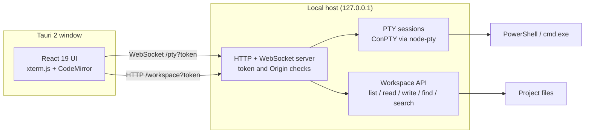

# macterm

**A macOS-style terminal for Windows with real tabs, tmux-style panes, themes, and a built-in code workspace.**

[](https://github.com/Software-DevLabs/terminal/actions/workflows/ci.yml)


macterm is a native Windows terminal that looks and feels like Terminal.app, but runs
real ConPTY shells and adds the workflow features a daily terminal needs: nested panes,
persistent tabs, configurable keybindings, and an editor workspace that opens at the
shell's current directory.

The desktop app is a Tauri 2 shell around a local Node.js PTY host and a React UI. It is
not a mock: every pane is a real PowerShell or `cmd.exe` process.

---

## Table of contents

- [Highlights](#highlights)
- [Keyboard shortcuts](#keyboard-shortcuts)
- [Getting started](#getting-started)
- [Building the Windows installer](#building-the-windows-installer)
- [Configuration](#configuration)
- [Code workspace](#code-workspace)
- [Architecture](#architecture)
- [Project layout](#project-layout)
- [Security model](#security-model)
- [Limits and notes](#limits-and-notes)
- [Testing and CI](#testing-and-ci)
- [Troubleshooting](#troubleshooting)

---

## Highlights

### Terminal

- Real Windows shells through ConPTY, hosted by a local Node.js process.
- xterm.js 6 with WebGL rendering, Unicode 11 width tables, WebLinks, and search.
- Scrollback, cursor style, blink, font family, and font size are configurable.
- Shell integration tracks the working directory with OSC 7, so new panes, tabs, and the
  code workspace start where you are instead of at the app's install folder.
- `Ctrl + Shift + K` clears the screen and the replay buffer, so cleared output never
  comes back after scrolling or reloading.
- Layout, tabs, panes, per-pane cwd, theme, font size, and keybindings survive restarts.

### Window and tabs

- Frameless native window with macOS traffic lights and rounded corners.
- Drag the titlebar to move; double-click it to zoom.
- Unfocused windows dim the traffic lights instead of hiding them.
- Tabs with live shell titles, pane-count badges, close buttons, and middle-click close.
- The window chrome switches between light and dark to match the active theme.

### Panes

- Split right or down, then split again in any direction to build nested layouts.
- Drag split handles to resize; the layout keeps normalized proportions on window resize.
- Geometric focus movement with `Alt + Arrow` picks the nearest pane in that direction.
- Focus cycling, pane zoom, equalize, and close-pane commands.
- Inactive panes are visually dimmed; the active pane receives keyboard focus.

### Code workspace

- Press `Shift + Alt + W` to open an editor over the terminal at the active pane's cwd.
- The workspace belongs to its terminal tab. Opening it in one tab never leaks into
  another tab, and each tab keeps its own open files and editor state.
- File explorer with folder expansion, monochrome file icons, and a filename filter.
- Full-text search across the whole workspace with `Ctrl + Shift + F`.
- CodeMirror 6 editor with syntax highlighting, line/column status, dirty indicators,
  and `Ctrl + S` save.
- Search results jump directly to the matching file and line.
- Read-only protection for oversized files; binary files are never decoded as text.

### Settings and themes

- Two built-in themes: **Basic** (light) and **Homebrew** (dark).
- Theme toggle with `Ctrl + Shift + L`; chrome colors follow automatically.
- Settings panel (`Ctrl + ,`) for theme, font size, and every global shortcut.
- Shortcut recorder rejects bare keys and duplicate bindings, and supports resetting
  individual actions to the configured defaults.
- Preferences are stored locally per app origin, so they survive restarts.

### Administrator mode

- The titlebar shield relaunches the installed app through the Windows UAC prompt.
- After elevation, macterm reopens with the layout and workspace state preserved.
- The shield only appears when macterm can elevate itself (packaged builds, not
  already elevated).

---

## Keyboard shortcuts

Global shortcuts are defaults and can be changed in **Settings** (`Ctrl + ,`). The
workspace keys marked as fixed are handled by the workspace itself.

### Tabs

| Shortcut | Action |
| --- | --- |
| `Ctrl + Shift + T` | New tab |
| `Ctrl + Shift + W` | Close active tab |
| `Ctrl + Alt + Left` | Previous tab |
| `Ctrl + Alt + Right` | Next tab |
| Middle click on a tab | Close that tab |

### Panes

| Shortcut | Action |
| --- | --- |
| `Ctrl + Shift + E` | Split right |
| `Ctrl + Shift + O` | Split down |
| `Alt + Left / Right / Up / Down` | Focus the nearest pane in that direction |
| `Ctrl + Shift + Space` | Cycle focus between panes |
| `Ctrl + Shift + Z` | Zoom the active pane |
| `Ctrl + Shift + U` | Equalize all pane sizes |
| `Ctrl + Shift + X` | Close the active pane |

### Terminal and appearance

| Shortcut | Action |
| --- | --- |
| `Ctrl + Shift + F` | Find in terminal scrollback |
| `Ctrl + Shift + K` | Clear screen and scrollback |
| `Ctrl + Shift + H` | Show the shortcut sheet |
| `Ctrl + Shift + L` | Cycle themes |
| `Ctrl + Shift + =` | Increase font size |
| `Ctrl + Shift + -` | Decrease font size |
| `Ctrl + Shift + 0` | Reset font size |
| `Ctrl + ,` | Open settings |
| `Shift + Alt + W` | Open or close the code workspace |

### Workspace

| Shortcut | Action |
| --- | --- |
| `Ctrl + S` | Save the active file (fixed) |
| `Ctrl + Shift + F` | Search file contents (fixed) |
| `Shift + Alt + W` | Close the workspace (configurable via the app keymap) |

### Find bar

| Key | Action |
| --- | --- |
| `Enter` | Next match |
| `Shift + Enter` | Previous match |
| `Esc` | Close the find bar |

---

## Getting started

### Requirements

| Requirement | Notes |
| --- | --- |
| Windows 10 or 11 | The desktop app uses ConPTY and WebView2. |
| Node.js 24 | Recommended runtime. `package.json` requires Node `>=23.6`. |
| Bun 1.x | Used for dependency installation, unit tests, and CI. |
| Rust stable + MSVC build tools | Only needed to build the Tauri desktop app. |
| WebView2 runtime | Ships with modern Windows; otherwise install the Evergreen runtime. |

### Run from source

```bash
bun install
bun run dev
```

`bun run dev` starts two processes with one generated token:

- the PTY host on `127.0.0.1:53124`
- the Vite dev server on `127.0.0.1:5173`

When Vite is ready, it opens the app in your browser with the token in the URL.

Run it without opening a browser:

```bash
MACTERM_NO_OPEN=1 bun run dev
```

Start the two pieces manually if you prefer:

```bash
# Terminal 1: shell host (a token is mandatory)
MACTERM_TOKEN=dev-token bun run dev:pty

# Terminal 2: Vite with the same token
MACTERM_TOKEN=dev-token bun run dev:web
```

### Useful scripts

| Command | What it does |
| --- | --- |
| `bun run dev` | PTY host + Vite with a shared random token |
| `bun run dev:pty` | PTY host only |
| `bun run dev:web` | Vite only |
| `bun run typecheck` | Type-check app and tests |
| `bun test` | Run unit tests (`bun test --watch` while developing) |
| `bun run build` | Build the frontend into `dist/` |
| `bun run build:bundle` | Fetch the bundled Node runtime, then build the frontend |
| `bun run check` | Typecheck + tests + production build |
| `bun run tauri:build` | Build the NSIS installer |

### Environment variables

| Variable | Purpose |
| --- | --- |
| `MACTERM_PORT` | PTY host port (default `53124`) |
| `MACTERM_WEB_PORT` | Vite port (default `5173`) |
| `MACTERM_TOKEN` | Shared auth token. `bun run dev` generates one automatically. |
| `MACTERM_NO_OPEN` | Set to `1` to stop the dev supervisor opening a browser |
| `MACTERM_NODE` | Node executable used by the packaged host or the dev supervisor |
| `MACTERM_NODE_DIST` | Mirror URL for the Node runtime download |

---

## Building the Windows installer

The installer bundles the frontend, the Node host, the PTY native module, and a Node
runtime, so the installed app does not need Node on the user's machine.

```bash
bun install
bun run build:bundle     # downloads Node 24 into vendor/node if missing
bun run tauri:build      # cargo + NSIS
```

The installer is written to:

```text
src-tauri/target/release/bundle/nsis/macterm_0.1.0_x64-setup.exe
```

Notes:

- `vendor/` is intentionally gitignored. `scripts/bundle-node.mjs` downloads the
  win-x64 Node runtime on the first bundle build.
- The installer is currently unsigned, so Windows SmartScreen may warn on first launch.
- The NSIS installer uses `currentUser` mode and does not require administrator rights
  to install. The app can elevate itself later through its shield button.

### Continuous integration

- **CI** (`.github/workflows/ci.yml`) runs on pushes to `main`, pull requests, and manual
  dispatch. It typechecks, tests, and builds on Ubuntu with Bun, then runs
  `cargo check` on `windows-latest`.
- **Release** (`.github/workflows/release.yml`) runs from a `v*` tag or manual dispatch.
  It builds the NSIS installer and uploads the `macterm-windows-nsis` artifact. Tagged
  runs also attach the installer to a draft GitHub release.

---

## Configuration

The host loads `config/default.json` and deep-merges an optional `config/user.json` over
it. UI changes made in Settings (theme, font size, keybindings) are stored separately in
the app's local storage and take precedence at runtime.

```jsonc
{
  "shell": "powershell",
  "theme": "mac-dark",
  "font": {
    "family": "Cascadia Mono",
    "size": 13.5
  },
  "scrollback": 10000,
  "cursorStyle": "block",
  "cursorBlink": true
}
```

Key sections:

| Key | Purpose |
| --- | --- |
| `shell` | Default shell key in the `shells` map |
| `shells` | Shell definitions: `label`, `path`, `args` |
| `theme` | Default theme key in the `themes` map |
| `themes` | Full ANSI palettes plus background, foreground, cursor, selection |
| `font` | Family and size |
| `scrollback` | Lines kept by xterm.js |
| `cursorStyle` / `cursorBlink` | `block`, `underline`, or `bar`, with optional blinking |
| `keymap` | Global action-to-chord map |

### Adding a shell

Add an entry under `shells`, then set `shell` to its key:

```jsonc
{
  "shell": "cmd",
  "shells": {
    "cmd": {
      "label": "Command Prompt",
      "path": "C:\\Windows\\System32\\cmd.exe",
      "args": []
    }
  }
}
```

PowerShell includes a prompt hook that emits OSC 7, which is what allows macterm to
follow the current directory. Other shells keep the last known cwd but will not report
directory changes unless they emit OSC 7 themselves.

### Adding a theme

Add a palette under `themes` using the same keys as the built-ins. The theme picker picks
it up automatically. The window chrome decides between light and dark from the
luminance of the theme background.

---

## Code workspace

Press `Shift + Alt + W` while a shell is focused. macterm opens a workspace rooted at
that pane's current directory.

- **Per-tab ownership.** Each terminal tab has its own workspace instance. Switching
  tabs hides the inactive workspace without unmounting it, so open files, cursor
  positions, and unsaved edits are preserved. A workspace in one tab is never shown in
  another tab.
- **Explorer.** Folders expand lazily. The filter matches file names under the current
  root; ignored folders such as `.git`, `node_modules`, `dist`, and `target` are skipped.
- **Content search.** `Ctrl + Shift + F` scans file contents and groups hits by file.
  Clicking a hit opens the file at that line.
- **Editor.** CodeMirror 6 detects the language from the file extension and highlights
  syntax with the active workspace palette. The status bar shows the path, line/column,
  encoding, and save state.
- **Saving.** `Ctrl + S` writes the active file. A dot marks unsaved files; closing a
  dirty file asks for confirmation. Save is disabled for read-only files.
- **Paths.** The project field shows the short folder name; click it to reveal the full
  path bar. Paths can be typed or pasted with either `/` or `\` separators.

The workspace API enforces the root it was given: reads, writes, listing, and searches
cannot escape that folder through `..`, absolute paths, or symlinks.

---

## Architecture



### Runtime flow

1. Tauri starts the bundled Node host with a random token and a stable local port.
2. The window loads the UI from the host (packaged) or from Vite (development).
3. Each pane opens a WebSocket to `/pty`. The host spawns or reattaches a ConPTY
   session, then replays its ring buffer so reloads do not lose scrollback.
4. Output is streamed as bytes to xterm.js; input and resize events flow back to the PTY.
5. The workspace talks to `/workspace/*` over HTTP, gated by the same token.

### Local API surface

| Endpoint | Method | Purpose |
| --- | --- | --- |
| `/health` | GET | Host version and live session summary |
| `/config` | GET | Runtime config and machine identity |
| `/pty?token=...` | WebSocket | Shell I/O, resize, clear-history, kill |
| `/workspace/system` | GET | Elevated state and elevation capability |
| `/workspace/list` | POST | List a directory inside the workspace |
| `/workspace/read` | POST | Read a UTF-8 text file |
| `/workspace/write` | POST | Save a text file |
| `/workspace/find` | POST | Filter file names |
| `/workspace/search` | POST | Search file contents |
| `/workspace/elevate` | POST | Relaunch through the Windows UAC prompt |

---

## Project layout

```text
src/                    React UI
  components/           Window chrome, tabs, panes, terminal, workspace, settings
  term/                 xterm.js setup, addons, clear-scrollback behavior
  state/                Tab and split-pane layout reducer
  client/               PTY WebSocket, workspace HTTP client, platform bridge
  hooks/                Persistent reducer and global keymap
  lib/                  Chord parsing, shortcut groups
  styles/               Application and workspace CSS
server/                 Local Node host
  index.ts              HTTP/WebSocket server, token and Origin checks, static hosting
  session.ts            PTY lifecycle, ring buffer, attach/detach
  workspace.ts          Filesystem, search, binary/size limits, elevation
  config.ts             default.json + user.json merge
shared/                 Types, defaults, keymap actions shared by UI and host
config/                 default.json and optional user.json
src-tauri/              Tauri 2 Rust shell, window setup, NSIS bundle config
scripts/                Dev supervisor, Node runtime bundler, icon, WS probe
.github/workflows/      CI and release pipelines
```

---

## Security model

macterm can spawn shells and read/write files, so its local server is deliberately
locked down:

- **Loopback only.** The host binds `127.0.0.1`; it is not reachable from the network.
- **Per-launch token.** Every request to `/pty` and `/workspace/*` needs the token. The
  token is generated on each launch for packaged builds and by the dev supervisor in
  development.
- **Origin gate.** Browser requests must come from `127.0.0.1` or `localhost`, which
  prevents a random web page from talking to the local host.
- **Workspace containment.** Paths are resolved with `realpath` and must remain inside
  the selected workspace root. Symlinks that escape the root are rejected.
- **Bounded work.** Directory listings, reads, writes, and searches have size and time
  caps; binary files are not rendered as text.
- **Local-only secrets.** The token stays in memory and the URL. It is not written to
  the repository or to configuration files.

Do not port-forward or reverse-proxy the host. Treat the token like a local password.

---

## Limits and notes

| Area | Limit |
| --- | --- |
| File listing | 2,000 entries per directory |
| File preview | 2 MB; larger files open read-only |
| File save | 8 MB per file; 16 MB request body |
| Content search | 500 hits, 30,000 scanned files, 1 MB per file, 8 s budget |
| Filename filter | 300 hits, 5 s budget |
| Terminal scrollback | Lives for the host's lifetime; not restored after the app exits |
| Elevation | Restarts the app; running shell processes do not survive the relaunch |
| Cwd tracking | Requires OSC 7. PowerShell has it built in; `cmd.exe` does not. |
| Installer | Unsigned; no auto-updater |

---

## Testing and CI

```bash
bun run typecheck   # strict TypeScript, app + tests
bun test            # layout reducer and clear-scrollback behavior
bun run build       # production Vite bundle
bun run check       # all of the above
```

Unit tests cover the split-pane reducer (`src/state/layout.test.ts`) and the
clear-scrollback terminal behavior (`src/term/clearScrollback.test.ts`). CI additionally
runs `cargo check` for the Tauri crate on Windows.

---

## Troubleshooting

**`MACTERM_TOKEN is required`**
Start through `bun run dev` (which creates a token) or export `MACTERM_TOKEN` before
running the host directly. The host refuses to start without it on purpose.

**The packaged app cannot start its shell host**
Build it with `bun run build:bundle` so `vendor/node/node.exe` exists and gets bundled.
For an unpackaged run, install Node 24 or point `MACTERM_NODE` at a Node executable.

**Blank window or "shell host never came up"**
Another process may be holding the preferred port. Close stale macterm instances and
relaunch. WebView2 must be installed and working.

**Shortcuts do not work while the workspace is open**
The workspace captures `Ctrl + S`, `Ctrl + Shift + F`, and `Shift + Alt + W` while it is
visible. Close the workspace to use the global terminal shortcuts again.

**The workspace opens in the wrong folder**
The workspace uses the active pane's last reported cwd. Change directory in the shell
and try again. If you use a shell other than PowerShell, it must emit OSC 7 for live
cwd tracking.

**SmartScreen blocks the installer**
The build is unsigned. Choose "More info" then "Run anyway", or build and sign the
installer yourself.

---

## Status

macterm is an actively developed desktop app at version `0.1.0`. The Windows desktop
build is the supported target; the browser development mode is intended for UI work and
testing.
